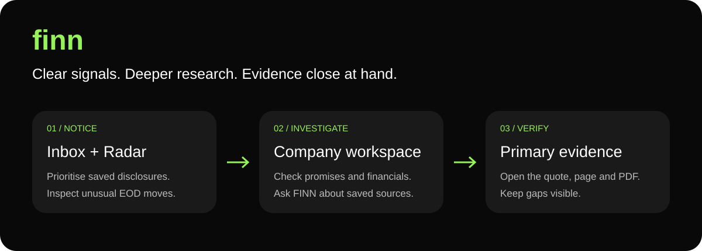
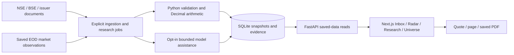

# FINN · Financial Investment Research Workspace



**Clear signals. Deeper research. Evidence close at hand.**

FINN is a mobile-first prototype for the ENAM AI Engineer Build Challenge. It helps a reviewer move from a prioritised disclosure to company research and the original evidence. The canonical app uses **Python FastAPI + SQLite** and **Next.js + TypeScript**. The `sites` branch contains the separate saved-data hosting port.

📖 [User manual](docs/USER_MANUAL.md) · 🧭 [Judge walkthrough](docs/JUDGE_GUIDE.md) · 🛠️ [Setup](docs/USER_MANUAL.md#install-and-run) · ✅ [Verification and limits](docs/usability-assistant-upgrade-2026-11-04.md)

## ✨ What distinguishes the approach

| Design choice | What the reviewer can inspect |
| --- | --- |
| 🔎 Evidence at the point of use | Open a cited quotation, PDF page, saved hash and original source from the finding. |
| 🧮 Deterministic financial arithmetic | Python Decimal calculations retain units, currency, periods and accounting basis; AI does not calculate reported changes. |
| 🗣️ Management accountability | Say–Do separates source coverage, comparable numerical targets, qualitative evidence and unresolved comparisons. |
| 🕰️ Point-in-time context | Radar separates filings known at the alert cutoff from later observations. Nearby does not imply causation. |
| 🛡️ Conservative missing states | Missing inputs stay missing. Banks use lender-specific schemas; unsupported statements do not become invented figures. |
| 🤖 Bounded AI assistance | Ask FINN searches saved passages for free; fresh AI summaries require an explicit model-enabled owner request and retain citations/review labels. |
| 📱 Progressive disclosure | Earlier compact light/dark workspace restored at the user’s request; the FINN welcome page and rolling company picker remain. Bottom navigation uses taps only. |
| 💾 Saved-only reads | Browsing never fetches upstream data or invokes a model. Explicit jobs handle new source discovery. |

These are implemented design choices, not a claim that FINN is the only product with them or that every research conclusion is verified.

## 🧭 A two-minute product tour

1. **Welcome** (`/`) → choose **Open workspace**. No signup is required.
2. **Inbox** → choose a time window, open a disclosure and inspect its primary evidence. Routine filings remain available.
3. **Radar** → expand filters, adjust price/volume thresholds and inspect the filing timeline.
4. **Research** → search for TCS or another company. Open **Ask FINN**, then follow a source citation.
5. **Say–Do audit** → distinguish quarters with sources from completed numerical comparisons.
6. **Financials / Sources** → inspect reported tables, applicable cash/debt analysis and saved original PDFs.

## 🏗️ Architecture



Screener is discovery/staging; Pull analytical claims require primary documents. The exact assessment universe has 18 companies, with five additional showcase companies. Aliases preserve ETERNAL/ZOMATO and the explicit TMPV/TMCV distinction.

## 🚀 Run locally

Follow the [complete installation and data guide](docs/USER_MANUAL.md#install-and-run). With dependencies and an existing saved database available:

```powershell
.\.venv\Scripts\python.exe scripts\run_local.py --build --production --public-review --db data\finn.sqlite3
```

Open [localhost:3000](http://localhost:3000). A fresh clone contains source and fixtures, **not the operator's database or keys**. Empty research is a visible missing-data state; see the manual for deliberate ingestion. Do not overwrite existing private configuration or data.

## ✅ Verification snapshot

On 4 November: **407 backend tests**, **77 frontend checks**, both production builds, hosted read-model tests and the router-bundle guard passed before this final Swiftz pass. Final pass results and cleanup decisions are recorded in [release readiness](docs/release-readiness-2026-11-04.md). Browser control is disabled on the current machine, so current rendered-browser/actual-device acceptance remains pending. Historical engineering acceptance counts are not financial-accuracy scores.

## ⚠️ Honest boundaries

- Saved observations are not live trading prices. Check each source/session date.
- Four quarters with sources do not guarantee four resolved comparisons. The saved four-company audit has one resolved numerical comparison across sixteen quarter slots.
- Unsupported annual layouts, unavailable sources and semantic review remain visible research gaps.
- AI output is a review-required draft, not investment advice. Fresh generation needs an operator-configured accessible model/key and may consume quota.
- Deployment is paused. The previously published URL has not been updated by this source push. Account access, live navigation, actual-device checks, data permissions and licensing remain release gates.
- Actual AI conversation export is a separate submission artifact; the decision log is not a fabricated transcript.

## 📁 Repository map

| Path | Contents |
| --- | --- |
| `backend/finn`, `backend/tests` | API, source pipeline, financial rules and regression fixtures |
| `frontend/app`, `frontend/tests`, `frontend/public` | App, interactions, local assets and UI checks |
| `scripts` | Local launch, source/export and validation tools |
| `docs` | Manual, judge guide, official briefs, reviewed plan and release notes |
| `hosting` / branch `sites` | Separate Worker/D1/R2 saved-data port; original Python stack stays on `main` |

## 🎨 Credits and rights

Swiftz reference design by Galuh: [Figma community file](https://www.figma.com/design/MCzGH0Vey4okYFpBcr7itx/Swiftz-App-by-Galuh--Community-). The welcome illustration/progress asset comes from its launch frames. FINN adapts the typography, solid surface palette and spacing to research workflows; it does not add the reference's trading or authentication flows. SF Pro is a system-font preference, not a redistributed font; DM Sans is bundled as fallback.

Company identity logos are stored locally with source URLs in `frontend/app/workspace/company-logos.json`; unavailable assets fall back to ticker initials. All 18 assessment symbols have local ribbon logos. Logos remain their owners' trademarks, with no endorsement implied. Source availability does not grant redistribution rights. See [third-party notices](frontend/public/third-party-notices.txt), [research/privacy notices](frontend/app/about/page.tsx) and the licensing gates in the handoff.
